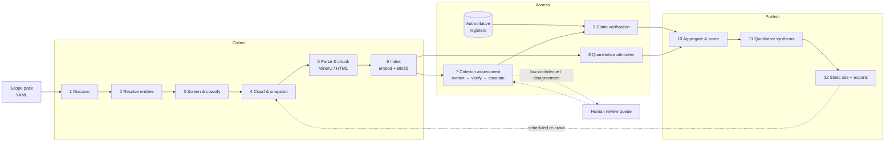

# Architecture

This document describes the domain-agnostic engine and the scope-pack contract. Read [README.md](README.md) first. Examples use the public illustrative pack in [`scopes/_example/`](scopes/_example/) (translation agencies); they are not the engine's focus.

---

## 1. Overview



Every stage:

- reads from and writes to the database (no hidden in-memory hand-offs),
- is **idempotent** and **resumable** (work units have status: `pending / done / failed / needs_review`),
- caches by content hash, so re-running with unchanged inputs costs nothing,
- records provenance (`run_id`, scope-pack version, prompt version, model id).

---

## 2. Core concepts

| Concept | Meaning |
|---|---|
| **Scope pack** | Declarative config for one landscape: segments, geography, vocabulary, sources, rubric, attributes, weight profiles, view config |
| **Entity** | A provider as the customer experiences it (brand/unit). Linked to one or more **legal entities** and to a **group** |
| **Group** | Corporate parent (e.g. a services group with units in 20 countries). Entities in a group are assessed separately but can inherit group-level documents (terms, policies) |
| **Site** | Physical location (office, facility, workshop) with geo-coordinates |
| **Market presence** | Entity × country × presence type (`hq`, `site`, `field_service`, `sales`, `remote`) + evidence |
| **Layer** | Named, nested set of countries (e.g. home ⊂ region ⊂ continent ⊂ global). Membership derived from market presence |
| **Segment** | Category of provider; many-to-many with entities |
| **Topic / Criterion** | Rubric row / cell. A criterion has a question, status definitions, retrieval hints and evidence rules |
| **Assessment** | Entity × criterion → status + evidence + rationale + confidence + provenance |
| **Attribute** | Typed quantitative/categorical fact (int, float, enum, bool, date) with evidence |
| **Snapshot** | Immutable copy of a fetched document (HTML/PDF) at a point in time |

---

## 3. Scope pack

Directory: `scopes/<name>/`. Only `scopes/_example/` is tracked in this repository; real packs are private checkouts (see [scopes/README.md](scopes/README.md)).

```
scopes/<name>/
├── scope.yaml          # metadata, perspective, segments, layers, languages
├── vocabulary.yaml     # multilingual search terms per segment/capability
├── sources.yaml        # discovery channels + authoritative registers
├── rubric.yaml         # topics, criteria, status scale, evidence rules
├── attributes.yaml     # quantitative fields
├── profiles.yaml       # weighting profiles
├── prompts/            # optional overrides of core prompt templates
├── seed/               # optional seed provider list
└── gold/               # hand-labelled entities for evaluation
```

### 3.1 `scope.yaml` (shape)

```yaml
id: example
version: 0.1.0
title: Translation agency landscape (illustrative)
perspective: >
  Organisation buying certified translation for regulated documents.

segments:
  - id: agency
    label: Agencies
    definition: Companies selling translation with in-house project management.
  - id: freelancer_network
    label: Freelancer networks
    definition: Platforms or cooperatives brokering independent translators.
    subtypes: [platform, cooperative]

layers:            # nested; order = inner → outer
  - id: home
    countries: [XA]           # placeholder ISO-like codes
    discovery_target: exhaustive
    rubric_depth: full
  - id: region
    countries: [XA, XB, XC]
    discovery_target: near_exhaustive
    rubric_depth: full
  - id: global
    countries: ["*"]
    discovery_target: notable
    rubric_depth: core        # full for shortlisted

languages:
  XA: [xa, en]
  default: [en]
```

### 3.2 `rubric.yaml` (shape)

The status scale is defined per scope so it can carry the right polarity (risk-oriented for consumer terms, capability-oriented for professional services).

```yaml
status_scale:
  - {id: strong,    label: Strong,     value: 3,    color: green}
  - {id: standard,  label: Standard,   value: 2,    color: grey}
  - {id: weak,      label: Weak,       value: 1,    color: orange}
  - {id: red_flag,  label: Red flag,   value: 0,    color: red}
  - {id: silent,    label: Not stated, value: null, color: white}
  - {id: na,        label: Does not apply, value: null, color: hatched}

topics:
  - id: certification
    label: Certification & quality
    criteria:
      - id: iso17100
        question: Is the provider certified to ISO 17100 by an accredited certification body?
        applies_to: [agency]
        statuses:
          strong:   Certified; certificate found in the certification body's public register.
          standard: Certified; certificate referenced but register entry not public.
          weak:     Claims certification without a certificate reference.
          red_flag: Claims certification that cannot be found, or it is withdrawn.
        retrieval_hints: ["ISO 17100", "certified", "certificate"]
        verify_with: certification_register     # triggers claim verification (stage 9)
        evidence_min: 1
```

Each criterion declares the segments it applies to (others get `na`). A segment may have **its own topics**: this is the genericity mechanism in practice — one scope pack, segment-specific rubric rows. A `rubric_depth: core` subset (≈12 criteria) is flagged for outer layers.

---

## 4. Pipeline stages

### 1 · Discover

Goal: a candidate list with high recall per segment × layer.

**Channels** (each tagged, so overlap can be measured; a scope pack picks which apply):

| Channel | How |
|---|---|
| Search | Query generation = segment terms × capability terms × language × country (`vocabulary.yaml`). LLM proposes synonyms → human approves |
| Certification / accreditation registers | National bodies and their public registers — search scopes for the relevant services |
| Professional registers | Person-level public registers (licensed or sworn professionals) where the scope needs them |
| Association / directory lists | Trade associations, sector directories, trade-fair exhibitor lists |
| Public tenders | Tender award notices (e.g. TED) filtered by classification codes + keywords |
| Publications | OpenAlex — institutions publishing on the scope's topics |
| Market signals | Startup/funding news, funding databases (paid, optional), conference programmes, vendor comparison pages (low tier — often vendor-authored), patents |
| Snowballing | "Partners", "our group", competitor mentions on already-crawled sites |
| LLM recall | Ask local + cloud LLMs for providers per segment/country — **treated as an unverified channel**, must be confirmed by another channel or a live website |

Output: `candidate(name, url, country_hint, segment_hint, channel, query, found_at)`.

**Recall estimation.** With ≥2 channels, overlap gives a rough population estimate (Chapman / log-linear capture–recapture). Channels are not independent, so this is an indicator, not a guarantee. For the innermost layer, a hand-built expert list is the reference.

### 2 · Resolve entities

- Normalise domains, names (strip legal-form suffixes), addresses.
- Match against registers for IDs via the `BusinessRegister` adapter (one implementation per country); VAT (VIES), LEI (GLEIF).
- Person-level register entries become `listed_professional` records linked to a company entity where one exists.
- Blocking + similarity (name trigram, domain, embedding of "about" text) → merge suggestions; uncertain merges go to review.
- Build **group** links (parent/subsidiary from register data, "part of X group" statements, shared domains).
- Assign **market presence** with evidence; derive layer membership.

### 3 · Screen & classify

- Fetch homepage + a few likely pages (services, about).
- Local LLM classifies: in scope? which segments? confidence. Embedding similarity to segment definitions as a cheap pre-filter.
- Borderline → review queue. Out-of-scope kept with reason (avoids re-discovering them).

### 4 · Crawl & snapshot

- `Fetcher` adapter wraps the own web scraping tool. Contract:
  ```python
  class Fetcher(Protocol):
      def fetch(self, url: str, *, render_js: bool = False) -> FetchResult: ...


  # FetchResult: final_url, status, content_type, body_bytes, headers, fetched_at
  ```
- Per-entity crawl policy from the scope pack: max pages, priority URL patterns (`/services`, `/about`, `/terms`, `/quality`, PDFs), languages.
- robots.txt, per-host rate limit, polite user agent.
- Raw bytes stored content-addressed (`sha256`) in object storage; `snapshot` row links entity, URL, hash, time.
- Also fetch authoritative documents: certificate/scope PDFs, register records.

### 5 · Parse & chunk

- HTML → clean Markdown (boilerplate removal), keep headings.
- PDF / scanned brochures / terms → **MinerU** → Markdown with page numbers; tables preserved.
- Language detection per chunk.
- Chunking: heading-aware, ~300–600 tokens, overlap; each chunk keeps `snapshot_id`, URL, page, heading path, char offsets.

### 6 · Index

- Embeddings on a local GPU service (multilingual model) → pgvector.
- BM25 / Postgres full-text in parallel.
- Retrieval for a criterion = hybrid (BM25 on `retrieval_hints` + vector on question) → top-k → **reranker** → top-n (e.g. 6) chunks per entity × criterion.

### 7 · Criterion assessment

Per entity × applicable criterion:

```
retrieve top-n chunks
   │
   ▼
Extractor (local, small)  ──► JSON: {status, quotes[], chunk_ids[], rationale}
   │
   ▼
Deterministic checks:  every quote appears verbatim in its chunk? status ∈ scale?
   │
   ▼
Verifier (local, different model) ──► agree / disagree + reason
   │
   ├─ agree & checks pass ─────────────► accept (confidence = high)
   ├─ disagree / check fail ──► cloud LLM adjudicates with same evidence
   │                              ├─ resolved ─► accept (confidence = medium)
   │                              └─ unclear ──► human review
   └─ no relevant evidence ───────────► status = silent ("Not stated")
```

- Structured output via JSON schema / constrained decoding (vLLM guided decoding).
- **Scraped text is untrusted input**: it is placed in a delimited evidence block; instructions inside it are ignored; output must match the schema and quotes must match verbatim.
- Group-level documents (e.g. shared general terms) can satisfy criteria for all group entities, marked as `inherited`.
- Cache key: `(entity, criterion_id, rubric_version, prompt_version, model_id, hash(evidence chunks))`.

### 8 · Quantitative attributes

- From registers (founding date, employees band, revenue where public, industry codes).
- From content (number of certified services, number of sites, stated turnaround days, languages) via structured extraction + same verification pattern.
- Derived (distance from a reference location, counts within a certificate scope).
- Retrieval per entity × attribute is BM25 on the label, an enum's allowed values and the optional `query_terms` list in `attributes.yaml`; the attribute definition (including `query_terms`) is part of the `attributes_extract` unit hash, so editing it re-executes the unit.

### 9 · Claim verification

Criteria with `verify_with` compare the extracted claim to an authoritative source. Typical verifier kinds (each an adapter a scope pack selects):

| Claim | Verified against |
|---|---|
| Accreditation / certification and its scope | National accreditation or certification registers (incl. withdrawn/suspended lists) |
| Management-system certification | Certification-body registers where automated access is permitted |
| Licensed / sworn professional status | Public professional registers |
| Company existence, age, size, financials | Business registers and filed financial statements |
| Group membership | GLEIF parent/child relationships, register data, group websites |
| Tender experience | Public tender award notices |
| Expertise / publications | OpenAlex |

Outcomes: `confirmed / not_found / contradicted / not_checkable`. A contradicted claim can downgrade a status (e.g. to `red_flag`) per the rubric rules. Evidence hierarchy is stored on each evidence item: `registry > formal_document > marketing_page > third_party`.

### 10 · Aggregate & score

- Topic score = mean of mapped status values over applicable, non-silent criteria; **coverage** = share of applicable criteria with evidence. Both always shown together.
- `silent` handling configurable per profile (neutral or penalty).
- **Weight profiles** (`profiles.yaml`) weight topics/criteria and filter segments/layers. No single global ranking.
- Market statistics per segment × layer: provider counts, capability coverage heatmap (capability × country), certification share, group concentration, **gaps** (capabilities no provider in a layer offers).

### 11 · Qualitative synthesis

- Per entity: 3–5 sentence profile generated from accepted assessments + attributes only (no new facts), each sentence citing evidence ids.
- Per segment × layer: landscape narrative (positioning clusters, notable specialists, gaps) generated by the cloud LLM from the aggregated data, with citations; reviewed before publishing.
- Optional clustering of entities by capability vectors / embeddings to reveal positioning groups.

### 12 · Publish

Static site generated from JSON exports:

| View | Content |
|---|---|
| **Map** | Sites and presence, filter by layer/segment/capability |
| **Mosaic** | One card per entity; rows = topics, cells = criteria, colour = status; hover → quote + source; toggle "assessment" vs "assessment + company facts" |
| **Compare** | 2–4 entities side by side, criterion by criterion with evidence |
| **Capability matrix** | Entities × capabilities heatmap |
| **Market** | Layer/segment statistics, gaps, concentration |
| **Entity page** | Profile, all evidence, attributes, change history |
| **Method** | Rubric, status definitions, sources, pipeline, versions, limitations |

Exports: Parquet/CSV/JSON of entities, assessments, attributes, evidence.

---

## 5. Data model (PostgreSQL)

```
scope(id, version, config_json)
run(id, scope_id, stage, started_at, finished_at, params_json, status)

group(id, name, registry_ids_json)
entity(id, scope_id, group_id, name, primary_domain, status, created_run)
legal_entity(id, entity_id, country, registry, registry_id, name, founded, employees_band)
site(id, entity_id, type, address, country, lat, lon)
market_presence(entity_id, country, presence_type, evidence_id)
entity_segment(entity_id, segment_id, confidence, evidence_id)

listed_professional(id, entity_id NULL, name, register, register_id, expertise_area, register_url, valid_until)

source(id, name, roles, access_class, licence, base_url, adapter)        -- catalogue from the scope pack's sources
candidate(id, name, url, country_hint, segment_hint, source_id, query, found_at, resolved_entity_id)

snapshot(id, entity_id, url, final_url, content_type, sha256, fetched_at, source_kind)
chunk(id, snapshot_id, seq, text, lang, page, heading_path, char_start, char_end, embedding vector)

assessment(id, entity_id, criterion_id, status, confidence, rationale,
           rubric_version, prompt_version, extractor_model, verifier_model,
           decided_by {auto|cloud_llm|human}, inherited_from_entity_id, run_id, created_at)
evidence(id, assessment_id NULL, attribute_value_id NULL, chunk_id NULL, source_id, quote,
         source_tier {registry|formal_document|marketing_page|third_party|expert_note})
claim_check(id, assessment_id, registry, outcome, details_json, checked_at)

attribute_value(id, entity_id, attribute_id, value_json, unit, confidence, run_id)

review_item(id, kind, ref_id, reason, priority, status, reviewer, decision_json, decided_at)
llm_call(id, run_id, model, purpose, prompt_hash, tokens_in, tokens_out, cost, latency_ms, cache_hit)
```

History: assessments are append-only; the "current" view is the latest per (entity, criterion, rubric_version). Diffs between runs power change tracking.

---

## 6. LLM routing

| Task | Default backend | Fallback |
|---|---|---|
| Synonym / query generation | Cloud LLM (once per scope, human-approved) | local large |
| Relevance screening, segment classification | local small | local large |
| Criterion extraction | local extractor | — |
| Verification | local verifier (different model family) | — |
| Adjudication | Cloud LLM | human |
| Attribute extraction | local extractor + verifier | cloud LLM |
| Entity profiles | local large | cloud LLM |
| Landscape narratives, rubric drafting | Cloud LLM | — |
| Embeddings, reranking | local GPU service | — |

Backends sit behind one interface (OpenAI-compatible client for vLLM; Anthropic client for Claude). Per-run budgets for cloud tokens; every call logged in `llm_call`.

---

## 7. Evaluation & quality

- **Gold set** (per scope pack, in its `gold/`): ~30 entities across all segments, hand-labelled by a domain expert on the full rubric (with evidence).
- Metrics per criterion: accuracy, Cohen's κ (auto vs. human), silent-rate, false "strong" rate (most harmful error).
- Discovery: recall vs. expert list (innermost layer), capture–recapture estimates elsewhere, precision of screening.
- Entity resolution: pairwise precision/recall on a labelled sample.
- Release gate per layer: thresholds defined in `eval/thresholds.yaml` (overridable per scope); criteria below threshold are published as "experimental" or hidden.
- Calibration loop: disagreements and review decisions feed prompt/rubric revisions (versioned).

---

## 8. Operations

- **Orchestration**: Python CLI (Typer) with stage commands; optional Prefect/cron for scheduled runs.
- **Re-crawl**: cadence per layer from the scope pack (e.g. monthly inner, quarterly outward); only changed snapshots (hash) trigger re-assessment.
- **Change tracking**: status changes, new/disappeared entities, certification changes → changelog page.
- **Deploy**: containers via docker compose; the static site is served behind a reverse proxy with access control unless a scope declares it public.
- **Observability**: stage metrics, LLM cost/latency, review queue length.

---

## 9. Legal & ethical constraints

- Respect robots.txt, rate limits and site terms; no scraping of login-walled content or social networks.
- Organisation-level data by default. Person-level data only from public professional registers, limited to what the register lists, linked to a company where possible; legitimate-interest assessment documented in the scope pack. No profiling of individuals.
- Keep licence and attribution per source (CC BY 4.0, CC0, national open-data licences …); honour sources whose terms bar automated access.
- A scope pack declares its purpose (internal evaluation vs. public site); the engine never publishes without it.

---

## 10. Genericity contract

The core must not contain domain words. A scope pack must be able to define:

- segments, layers, languages, vocabulary
- discovery channels and register adapters (from a library of adapters: `BusinessRegister`, `AccreditationRegister`, `ProfessionalRegister`, `TenderSource`, `PublicationSource`, `Search`, `Fetcher` — each with per-country/per-site implementations that any scope can reuse)
- rubric with any status scale and polarity
- attributes and weight profiles
- view configuration (which views, labels, colours)

**Acceptance test**: `scopes/_example/` and at least one private scope run with zero changes to `core/`.

---

## 11. Technology choices (initial, revisit in decision records)

| Area | Choice | Why |
|---|---|---|
| Language | Python 3.12+ | Ecosystem for scraping, MinerU, LLM clients |
| DB | PostgreSQL 16 + pgvector | One store for relational + vectors + full-text |
| Raw storage | Filesystem or MinIO, content-addressed | Immutable snapshots, cheap dedup |
| Analytics | DuckDB over Parquet exports | Fast ad-hoc analysis |
| Config validation | Pydantic models for scope packs | Fail fast on bad YAML |
| Frontend | Static site (e.g. Astro/Svelte) + MapLibre | Host anywhere, no backend |
| Review UI | Minimal web page over `review_item` (or Label Studio) | Keep humans fast |
